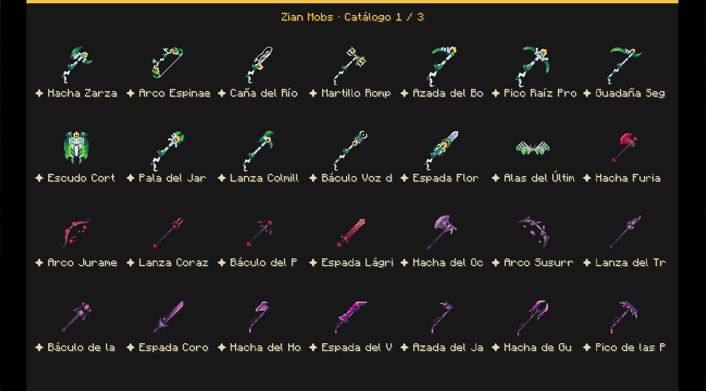

# Zian Mobs

Animated creatures, combat NPCs, configurable wave encounters and fantasy equipment for Minecraft 1.21.1.

## Requirements

- Minecraft 1.21.1, Java 21, NeoForge 21.1.259 or newer in the 1.21.1 series.
- GeckoLib 4.9.3 or a compatible 4.x version.
- Install Zian Mobs and GeckoLib on **both client and server**.
- Standalone mod: Zian Manager, MythicMobs and ModelEngine are not required.

## Features

- Three Cursed One variants and Oni Brute with animations.
- Combat NPCs with seven appearances, melee equipment, bows and configurable sonic, dragon, Wither and blaze attacks without terrain destruction.
- In-game administrator interface with search, grouped forms and GUI scales 2, 3 and 4.
- Wave zones, spawn-point wireframes, public wave/countdown displays and boss bars.
- Personal rewards with durable delivery records, pending deliveries and administrative review.
- 46 fantasy equipment and decorative items plus five spawn eggs. No armor is included.
- Enhanced bows, collection effects, critical-hit healing, safe staff attacks, a protective shield, revival wings and an edible blessed rupee.

## Getting started

Install matching versions on both sides, back up your world and run `/zianmobs` as an operator (permission level 2). Create a creature or NPC, configure its rewards, then create a zone with a team and spawn points. No natural spawning or encounter zones are enabled automatically.

Players can use `/zianmobs pending` to check pending rewards. Data remains isolated per world. Upgrading from beta.8 keeps existing `zianmobs:` identifiers, items and zone data; replace the previous JAR rather than keeping two copies.

[Spanish guide](docs/GUIA_ES.md) · [Changelog](CHANGELOG.md) · [Issues](https://github.com/IANBLK/Zian-Mobs/issues)

## Equipment abilities

- Carnivoret: poison for 2 seconds, except the scythe. The scythe deals 14 total attack damage and heals 10% maximum health on a critical hit, plus regeneration I for 5 seconds.
- Crimson Ruby: bleeding for 2 seconds. Dark Queen: Wither for 2 seconds. Purple World: weakness for 2 seconds.
- Valentines: critical hits heal 10% maximum health and grant regeneration I for 5 seconds.
- Master Sword: critical hits heal 20% maximum health and grant regeneration I for 10 seconds.
- Hylian Shield: a successful block grants resistance I and regeneration I for 10 seconds.
- Staffs cast sonic, Wither-skull or dragon attacks using right click.
- Ability cooldowns are 30 seconds; healing shares one cooldown across weapons and survives reconnects. Carnivoret and Valentines hammers deal 13 and 11 total attack damage respectively.

## Build

Use Java 21 and `./gradlew build` (`gradlew.bat build` on Windows). GeckoLib and SQLite JDBC dependencies are resolved through Gradle. The optional `-PgeckolibJar=...` and `-PsqliteJdbcJar=...` properties support local development dependencies. Build output, worlds, local libraries, private archives and credentials are not tracked.

## License and artwork

Original code is **MIT**; see [LICENSE](LICENSE). Third-party models, textures, animations and skins retain their original licenses and are **not MIT-licensed**. The maintainer confirmed permission to publish the included artwork with this project. See [artwork notice and credits](ARTWORK-NOTICE.txt). This does not grant permission to extract or resell those assets independently.

GeckoLib is a required separate dependency. SQLite JDBC is bundled with its own license notices. This project is not affiliated with or endorsed by Mojang, Microsoft or Nintendo.
